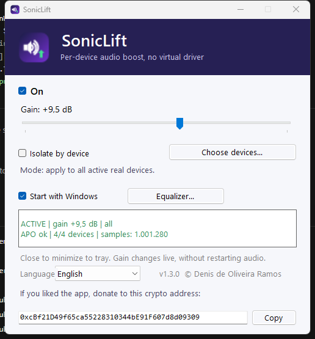

# SonicLift

**Mais volume em qualquer dispositivo — sem driver virtual.**

[English](README.md) · **Português** · [Español](README.es.md)


<p align="center">
  
</p>

O SonicLift é um **APO nativo do Windows** (Audio Processing Object) que aplica
ganho e limiter **dentro** do dispositivo de saída. **Não cria placa de som
virtual, não adiciona um dispositivo extra para selecionar e não coloca um
driver no meio.** O Windows continua trocando entre fone, caixa Bluetooth, USB
e HDMI — e o efeito acompanha o dispositivo.

## Por que mais um booster de volume?

- Caixas de notebook e Bluetooth muitas vezes são **baixas demais**.
- Drivers virtuais adicionam uma camada no meio e um “dispositivo” a mais.
- Ferramentas APO poderosas existem, mas são **complexas** para a maioria.
- Ferramentas fáceis costumam usar dispositivo virtual, que pode atrapalhar a
  troca de dispositivo que já funciona.

O SonicLift faz o caminho oposto: **um botão, até +30 dB com limiter, no
dispositivo que o Windows já está usando**.

## Destaques

- **Ganho até +30 dB** com limiter sempre ligado.
- **Equalizador de 10 bandas** com presets (Flat, Music, Gaming, Bass, Voice, Movie).
- **Graves, Surround e Clareza** para ajuste rápido e amigável.
- **Headroom automático** para o EQ não clipar.
- **Importar/exportar perfis de EQ** para salvar e compartilhar ajustes.
- Aplica em **todos os dispositivos reais ativos** por padrão (USB, Bluetooth,
  HDMI, S/PDIF).
- **Isolar por dispositivo** com lista sem duplicados (agrupa perfis do mesmo
  fone/caixa Bluetooth).
- **Segue a troca de dispositivo do Windows** — sem dispositivo virtual.
- **Ganho ao vivo**: o slider aplica na hora.
- **Iniciar com o Windows**, bandeja, instância única, aviso ao minimizar.
- **Inglês (padrão), português e espanhol**.
- **Sem rede, sem telemetria, sem coleta de dados.**

## SonicLift x alternativas

| | **SonicLift** | **FxSound** | **Equalizer APO** | **Boom 3D** | **SteelSeries Sonar** |
|---|---|---|---|---|---|
| APO nativo (sem dispositivo virtual) | ✅ Sim | ❌ Dispositivo virtual | ✅ Sim | ❌ Dispositivo virtual | ❌ Dispositivo virtual |
| Aumento de volume | ✅ até +30 dB | ✅ | ✅ preamp | ✅ | ✅ |
| Limiter | ✅ sempre ligado | ✅ | ➖ manual | ✅ | ✅ |
| Equalizador | ✅ 10 bandas | ✅ 9 bandas | ✅ avançado / VST | ✅ 31 bandas | ✅ 10 bandas |
| Presets | ✅ 6 embutidos | ✅ | ➖ manual | ✅ | ✅ |
| Graves / Surround / Clareza | ✅ | Só graves / limitado | ⚙️ filtros | ✅ | ✅ |
| Controle por app | ➖ por dispositivo | ➖ limitado | ⚙️ via config | ✅ | ✅ |
| Idiomas | ✅ EN / PT / ES | EN | EN | EN (+ varia) | EN |
| Rede / telemetria | ✅ nenhuma | open-source | open-source | varia | conta / varia |
| Preço | **Grátis (pessoal)** | Grátis | Grátis | Pago | Grátis (hardware) |

> **Nota honesta:** o SonicLift agora tem **EQ de 10 bandas, presets, Graves,
> Surround e Clareza**, com headroom automático para não clipar. Não é uma
> ferramenta de 31 bandas/VST — o foco é a experiência simples e nativa no
> dispositivo, com limiter de verdade.

## Funciona com todos os apps

O SonicLift processa **áudio em modo compartilhado em dispositivos reais** —
jogos, navegadores, música, sons do sistema, apps de comunicação e vários apps
ao mesmo tempo.

Limites técnicos:

- Apps em **WASAPI exclusive / ASIO** ignoram qualquer APO.
- **DRM / áudio protegido** pode recusar áudio por causa do
  `DisableProtectedAudioDG=1`.
- Apps **roteados para dispositivo virtual** (FxSound, Voicemeeter, VB-Audio)
  ficam fora. Mantenha em *Default* / dispositivo real.
- O **Mixer de volume** do Windows só lista apps com sessão ativa; ausência não
  é bug.

## Instalação

1. Baixe o instalador em [Releases](https://github.com/denoso1993/soniclift/releases).
2. Execute `SonicLiftSetup-*.exe` como **Administrador**.
3. Abra o SonicLift, deixe **Ligado**, ajuste o ganho e, se quiser, marque
   *Iniciar com o Windows*.

Requisitos: Windows 10/11 **x64**. O APO é **não assinado**.

## Segurança e transparência

- Veja [SECURITY.md](SECURITY.md): chaves de registro, arquivos e tarefa que o
  app altera, além da desinstalação.
- **Sem rede, sem telemetria, sem coleta de dados.**
- Hashes: [SHA256SUMS.txt](SHA256SUMS.txt).
- Conteúdo com DRM pode recusar áudio; apps em modo exclusivo ignoram o APO.

## Doação

Gostou do app? Doe para este endereço **crypto**:

```
0xcBf21D49f65ca55228310344bE91F607d8d09309
```

## Autor

Desenvolvido por **Denis de Oliveira Ramos** — https://github.com/denoso1993

## Licença

Proprietária (All Rights Reserved). Cópia, redistribuição, modificação ou
engenharia reversa são proibidas sem autorização. Veja [LICENSE](LICENSE).
